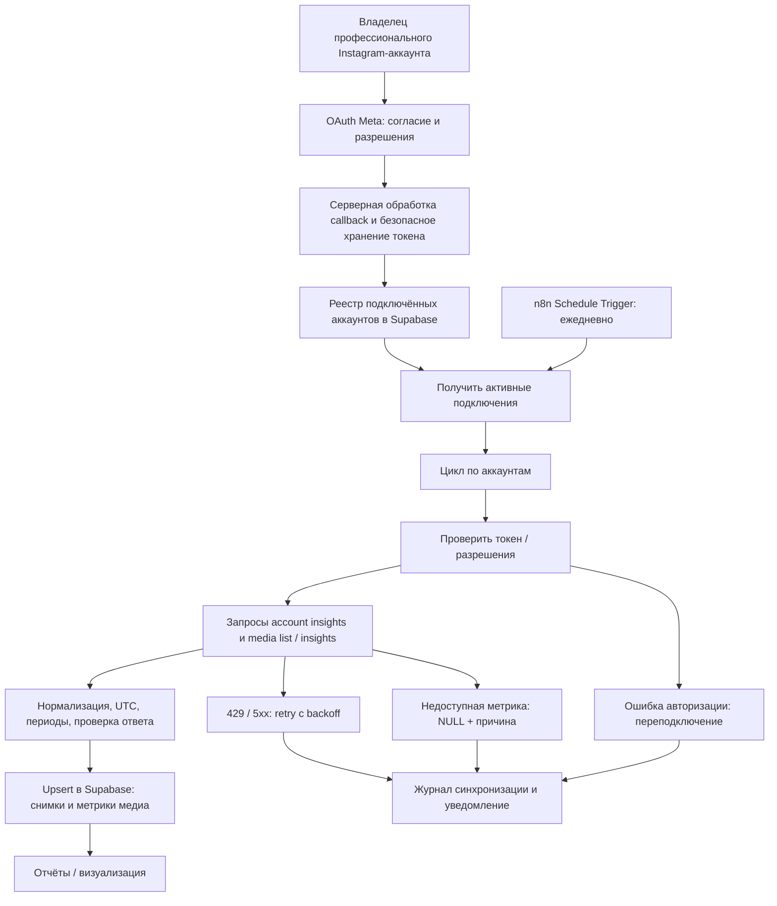

# Архитектура и поток данных

## Визуальная схема

Исходник схемы: [architecture.mmd](architecture.mmd). GitHub отображает Mermaid непосредственно в Markdown.

## Компоненты
| Компонент | Назначение |
|---|---|
| Meta OAuth / Instagram API | Авторизация и получение разрешённых данных аккаунтов и публикаций |
| Серверная функция/обработчик OAuth | Обмен кода на токен, обновление при поддержке выбранного сценария, шифрованное хранение; **не браузер** |
| n8n | Планирование, обход аккаунтов, запросы, нормализация, повторы, логирование |
| Supabase PostgreSQL | Реестр подключений, история снимков и метрик, журнал запусков |
| Панель отчётности | Чтение агрегированных результатов с разграничением доступа |

## Логическая схема БД (проект, не SQL миграция)

**instagram_connections**: `id uuid PK`, `owner_id uuid`, `ig_user_id text UNIQUE`, `username text`, `auth_flow text`, `status text` (active/reconnect_required/disabled), `token_secret_ref text`, `token_expires_at timestamptz NULL`, `last_sync_at timestamptz NULL`, `created_at timestamptz`.

**instagram_account_metrics**: `connection_id uuid FK`, `metric text`, `period text`, `period_start timestamptz`, `period_end timestamptz`, `value numeric NULL`, `unavailable_reason text NULL`, `collected_at timestamptz`, `source_api_version text`. Уникальность по `(connection_id, metric, period, period_start, period_end)`.

**instagram_media**: `connection_id uuid FK`, `ig_media_id text`, `media_type text`, `published_at timestamptz`, `permalink text NULL`, `caption_excerpt text NULL`. Уникальность по `(connection_id, ig_media_id)`.

**instagram_media_metrics**: `connection_id uuid FK`, `ig_media_id text`, `metric text`, `snapshot_at date`, `value numeric NULL`, `unavailable_reason text NULL`, `collected_at timestamptz`, `source_api_version text`. Уникальность по `(connection_id, ig_media_id, metric, snapshot_at)`.

**instagram_sync_runs**: `id uuid PK`, `connection_id uuid FK`, `started_at`, `finished_at`, `status`, `request_count`, `error_code`, `error_summary`, `retry_count`.

**Примечания:** для медиа `snapshot_at` фиксирует дату снимка, а не обязательно период метрики. Для account insights границы периода сохраняются из фактического ответа API; если API возвращает lifetime или иной формат, модель нормализуется с сохранением исходной семантики. Секреты **не** сохраняются открытым текстом в таблицах. RLS: только разрешённые владельцы/сотрудники видят результаты; запись — серверная роль с минимально необходимыми правами.

## Набросок n8n workflow
1. **Schedule Trigger** (ежедневно, часовой пояс согласовать).
2. **Получение подключений** со статусом `active`.
3. **Loop Over Items**: отдельно по каждому аккаунту.
4. **Проверка токена** и выбор корректного API base URL для выбранного OAuth flow.
5. **HTTP Request**: сведения об аккаунте / account insights.
6. **HTTP Request**: список медиа с пагинацией; для каждого — поддерживаемые media insights.
7. **Code**: приведение типов, дат, периодов; различение `0` и `NULL`.
8. **Upsert**: аккаунт/медиа/метрики по составным ключам, без дублирования.
9. **Журнал запуска**: статус, число записей, ошибки, длительность.
10. **Error workflow / уведомление**: запрос на переподключение, временные сбои, лимиты.

Для большого числа медиа использовать инкрементальную синхронизацию и отдельное окно повторного обновления последних публикаций. Контролировать пагинацию и ограничения API; не запрашивать всю историю ежедневно.
